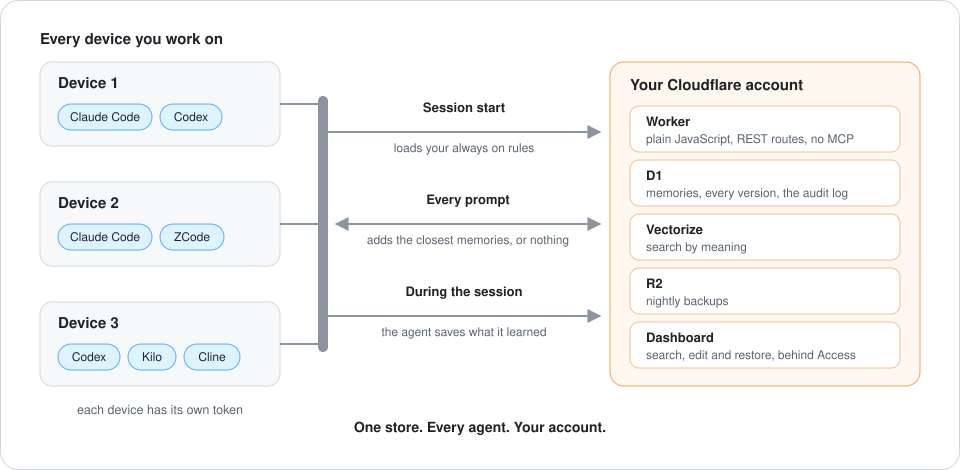

# Anymem

**Shared memory for coding agents, in your own Cloudflare account.**

[](https://github.com/dhlotter/anymem/actions/workflows/test.yml)
[](LICENSE)


Tell one agent something once. Every agent on every machine knows it next time, Claude Code on your laptop, Codex on a server, ZCode at work. The memory lives in a Worker, a D1 database and a Vectorize index that you own.

<p align="center">
  
</p>

## Why it exists

1. **Agents forget.** Every new session starts from zero, so you repeat the same corrections, preferences and decisions.
2. **Every tool keeps its own memory.** What Claude Code learned is invisible to Codex, and neither follows you to another machine.
3. **Hosted memory services keep your data.** Your working notes end up in someone else's database.
4. **MCP servers are an opaque tool surface.** The agent calls tools you cannot easily audit, and the server decides what comes back.

Anymem is one store you own, read and written by every agent through hooks and short scripts you can read in an afternoon.

## How it works

1. **Session start.** A hook loads the capsule, your always on rules, into the agent's context.
2. **Every prompt.** A hook searches the store and adds the closest memories. When nothing is relevant it adds nothing.
3. **During the session.** The agent saves corrections, confirmed decisions and preferences itself, with the session's own model. In Claude Code and Codex a short review turn now and then catches what it missed.
4. **End of session.** A capture hook reads what was said and adds anything durable the agent did not save.
5. **Every night.** The Worker merges near duplicates, backs everything up to R2, and moves captures nobody recalled in 60 days to the trash.

A second machine connects with a connection string. Each device gets its own token, and you can revoke one without touching the others.

## Quick start

You need a Cloudflare account, a Cloudflare API token (`setup.py --scopes` prints the permissions), Python 3.9 or newer and git. No Node.js, no Wrangler.

```bash
git clone https://github.com/dhlotter/anymem && cd anymem
bash scripts/bootstrap.sh
```

1. **Bootstrap** fetches the repo to `~/.local/share/anymem` (or uses the clone you run it from) and starts `init.py`.
2. **Init** asks whether to create a new store or connect to one you already have, wires every harness it finds, runs the doctor and lists what only you can do next.
3. **Doctor** proves it works.

```bash
python3 skills/anymem/scripts/doctor.py --probe
```

Claude Code takes its hooks from the plugin.

```bash
claude plugin marketplace add dhlotter/anymem
claude plugin install anymem@anymem
```

The full walk through, a second machine and every setting are in [install](docs/install.md).

## Works with

| Tier | Harnesses |
|---|---|
| Supported, used every day and checked on each release | Claude Code, Codex, ZCode |
| Best effort, each with live proof in its guide | Antigravity (agy), DSH, Kilo, Cline |

It works in coding agents that run hooks or plugins, in a terminal or a desktop app. It does not work in browser chats such as claude.ai or chatgpt.com, because they run no hooks and anymem has no MCP server on purpose. Each harness has a guide in [docs/harnesses](docs/harnesses), and a new one takes one adapter, see [add a harness](docs/add-a-harness.md).

## What makes it different

1. **Readable source.** The Worker is plain JavaScript modules with no dependencies, no bundler and no build step. The client is Python standard library only. The code that runs is the code you read.
2. **No MCP and no server generated commands.** Agents run fixed scripts from this repo and hooks call REST routes. A reply from the Worker is data, never a command.
3. **An audit trail.** Every call from a script or hook lands in `~/.cache/anymem/audit.log`, and every authenticated request gets a row in the Worker's `audit` table for 90 days. Neither holds memory text or a secret.
4. **Nothing writes unasked.** No digests, summaries or insights. Memories come from you, your agent or the capture hook, which you can switch off.
5. **Memories are data, not instructions.** Injected blocks say so, the Worker refuses a capture that reads like an instruction, and every hit carries where it came from.
6. **Captures are on probation.** One not recalled within 60 days goes to the trash, and stays restorable for 14 more.

## Measured, not claimed

Measured by the author on a copy of their own store, about 930 memories, on the dates in [benchmark](docs/benchmark.md).

| Measure | Result |
|---|---|
| Recall ranking, 58 benchmark questions (MRR) | 0.853 |
| Real prompts that should inject nothing, and did not | 47 of 50 |
| Real prompts that should find a memory, and did | 31 of 50 |
| Time for one recall | median about 1.3 s |
| Move of a 1,076 memory store from version 1, twice | 0 differences |

<details>
<summary><b>What is not proven yet</b></summary>

1. Setup has never run from a brand new Cloudflare account. It ran for real once, as a rehearsal on the author's account, with a workers.dev address, no Access and no custom domain.
2. The installer's Access step and its custom domain step have only run against a fake Cloudflare API in the tests.
3. The dashboard's browser login has not been exercised on a real hostname. Service token calls through Access have.
4. The effect of the in session save rules and the review turn has not been measured yet. Before them, agents saved by hand in 2 of 30 sessions.
5. Recall misses short chat prompts whose memory is about earlier context, and it is short of the 0.80 hook hit bar on the holdout set (11 of 16) and on exact identifiers (16 of 20).
6. The tools that move a version 1 store to version 2 have only run on a copy of the author's store. See [migration](docs/migration.md).

</details>

## What it does not do

1. No MCP server, no claude.ai or Cowork connector, no OAuth.
2. No teams and no sharing. One person, one store.
3. No offline recall. Session start uses a cached capsule when the Worker is away, and a prompt just gets no memories.
4. No encryption beyond what Cloudflare does. Whoever holds your Cloudflare account can read the store, and your agent's model provider sees whatever is injected into a prompt.
5. It refuses health, money, legal and identity details in a capture. How reliably it refuses is not measured.

## Cost

Free on the Cloudflare free plan up to about 4,000 memories, where the vector index fills. Past that, Workers Paid at 5 US dollars a month. The full table is in [limits](docs/limits.md).

## Status

An early release, built for the author's own setup first and shared as is. One maintainer, best effort, macOS and Linux. Issues are switched off. Security reports go through [SECURITY.md](SECURITY.md). Forks are welcome under the MIT license.

<details>
<summary><b>Documentation</b></summary>

1. [Install, upgrade, uninstall and the configuration reference](docs/install.md)
2. [Commands, one section per skill script](docs/commands.md)
3. [Architecture, the Worker, the client, hooks and adapters](docs/architecture.md)
4. [Security and audit](docs/security.md)
5. [Privacy, what leaves your machine](docs/privacy.md)
6. [Capture and probation](docs/capture-design.md)
7. [Recall](docs/recall.md)
8. [Backups and restore](docs/backups.md)
9. [Dashboard](docs/dashboard.md)
10. [Subjects and the automatic part](docs/subjects.md)
11. [Profile and people](docs/profile-design.md)
12. [Migration from version 1](docs/migration.md)
13. [Troubleshooting](docs/troubleshooting.md)
14. [Add a harness](docs/add-a-harness.md)
15. [Limits and costs](docs/limits.md)
16. [Cloudflare resources, and running without a domain](docs/cloudflare.md)
17. [Benchmark](docs/benchmark.md)
18. [Why scripts and hooks, not MCP](docs/why-skill-not-mcp.md)
19. [The Worker, its routes, settings and internals](worker/README.md) and [worker/ARCHITECTURE.md](worker/ARCHITECTURE.md)

</details>

## License

MIT. See [LICENSE](LICENSE) and [NOTICE](NOTICE).
